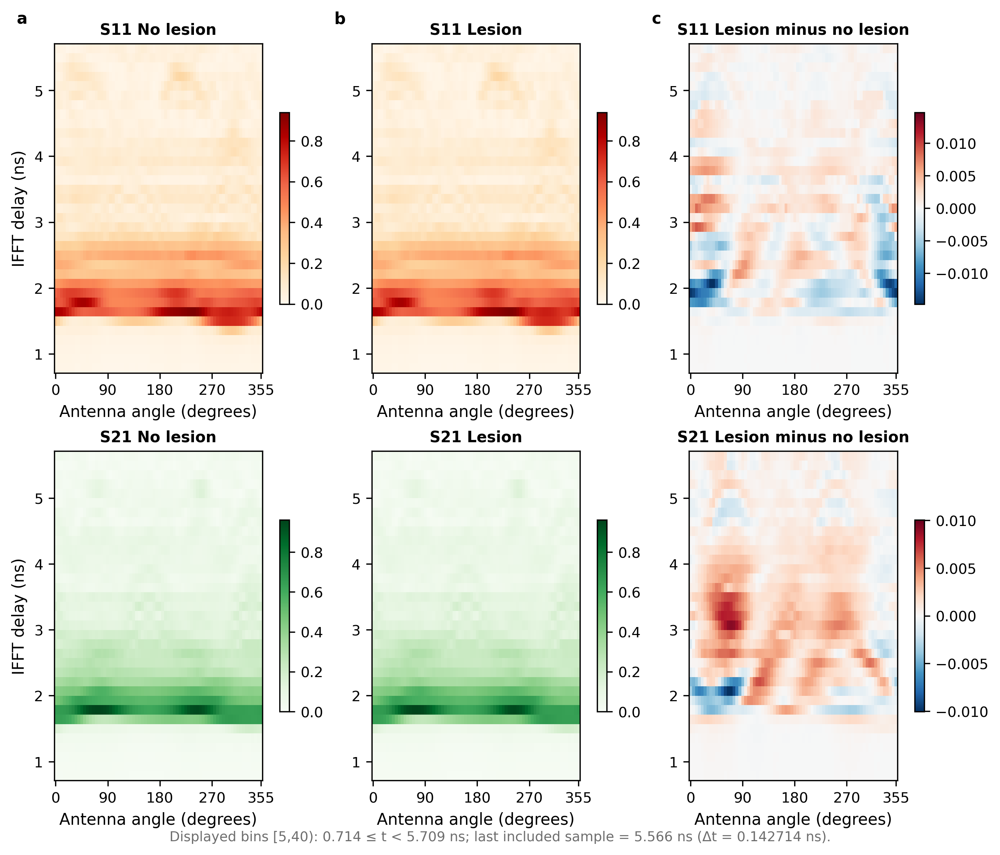

# Leakage-controlled validation on UM-BMID

This repository contains the code and curated outputs for a strict reanalysis of the public University of Manitoba Breast Microwave Imaging Dataset (UM-BMID). The reproducible entry point is the *official, already-cleaned* `*_emp.pickle` files, not raw scanner files. The study evaluates a compact physics-guided representation under phantom-disjoint validation, signal-destruction ablations, within-phantom label permutation, and S11-only cross-hardware transfer.

The contribution is an evaluation and reproducibility study, not a new clinical dataset or a deployable diagnostic system. The held-out test set contains four phantom groups (40 measurements), and the decision threshold is unstable across grouped folds. Results should therefore be interpreted as evidence about ranking under controlled phantom experiments, not clinical performance.

## Reported results

| Analysis | Main result |
|---|---:|
| Fixed phantom-disjoint Gen2 test | ROC AUC 0.925 (95% bootstrap CI 0.835–0.985) |
| Five-fold grouped evaluation | ROC AUC 0.877 ± 0.078 |
| Five-fold specificity | 0.660 ± 0.357; fold range 0.05–1.00 |
| Late-time gate, bins `[40,75)` | ROC AUC 0.595 |
| Angular-order shuffle | ROC AUC 0.500 |
| Within-phantom permutation, 200 repeats | mean null AUC 0.506; one-sided p = 0.00498 |
| Direct S11-only Gen1 → Gen2 | ROC AUC 0.505 |
| Direct S11-only Gen2 → Gen1 | ROC AUC 0.418 |
| Validation-selected Khalid-style ResNet, fresh GPU rerun | ROC AUC 0.758; sensitivity 0.750, specificity 0.250 |

Machine-readable outputs are in [`results/`](results/README.md). The committed figures were generated from the corrected experiment outputs.



## Repository layout

```text
configs/                         transparent manuscript group split
docs/                            data and reproducibility notes
results/                         curated JSON, CSV, PNG, PDF, and SVG outputs
scripts/build_gen2_aligned.py    align Gen2 S11 and S21 clean files by measurement ID
scripts/create_fixed_split.py    convert group identities to sample indices
scripts/make_figure1_design.py   regenerate the design diagram and model label
scripts/run_gen2_supplementary.py
scripts/make_publication_figures.py
scripts/build_gen1_aligned.py
scripts/run_cross_generation_s11.py
src/umbmid_validation/core.py    shared features, metrics, and leakage checks
tests/                           data-free unit tests
```

## Installation

Python 3.10 or newer is recommended.

```bash
python -m venv .venv
# Windows: .venv\Scripts\activate
# Linux/macOS: source .venv/bin/activate
python -m pip install --upgrade pip
python -m pip install -e .
```

`requirements-lock.txt` records one tested Windows/Python 3.13 environment with exact versions; the paper's original GPU training environment was not archived. For a locked CPU verification environment, create a fresh Python 3.13 virtual environment and install `python -m pip install -r requirements-lock.txt` before `python -m pip install --no-deps -e .`. This lock is platform-specific, not a claim of bit-for-bit GPU retraining.

Install the optional PyTorch baselines with:

```bash
python -m pip install -e ".[deep-learning]"
```

## Data preparation

The UM-BMID signals are not redistributed here. Download the official `fd_data_*_emp.pickle` and `md_list_*_emp.pickle` files from [IEEE DataPort (DOI 10.21227/1Y0Z-8T98)](https://doi.org/10.21227/1Y0Z-8T98) and keep them outside Git. Those files already have empty-chamber subtraction applied by the UM-BMID upstream workflow. The upstream raw-to-clean script and the boundary of this repository's reproducibility claim are documented in [`docs/DATA.md`](docs/DATA.md). We do **not** claim raw-scanner-file-to-result reproduction.

The source geometry, calibration process, and hashes of the local clean inputs are documented in [`configs/acquisition_manifest.json`](configs/acquisition_manifest.json). The known Gen1/Gen2 antenna-origin difference is not corrected by the reported S11 transfer analysis; the transfer result is an observed acquisition-domain shift, not a causal hardware-mechanism estimate.

After creating `data/processed/gen2_s11_s21_aligned_dataset.npz`, materialize the published split:

```bash
python scripts/create_fixed_split.py \
  --dataset data/processed/gen2_s11_s21_aligned_dataset.npz \
  --config configs/fixed_split_groups.json \
  --output data/processed/gen2_group_split_indices.npz

python scripts/validate_dataset.py \
  --dataset data/processed/gen2_s11_s21_aligned_dataset.npz \
  --split data/processed/gen2_group_split_indices.npz
```

The validation command must report 200 samples, 20 phantom groups, balanced classes, and mutually exclusive train/validation/test groups before the manuscript experiment is run.

## Reproduce the Gen2 analyses

```bash
python scripts/run_gen2_supplementary.py \
  --dataset data/processed/gen2_s11_s21_aligned_dataset.npz \
  --split data/processed/gen2_group_split_indices.npz \
  --output outputs/gen2 \
  --seed 20260910 \
  --bootstrap 3000 \
  --permutations 200
```

Each permutation repeats the complete logistic-regression regularization search on the permuted development labels. Labels are shuffled only within each phantom group. This mirrors the observed-label search and prevents an artificially weak null procedure.

Generate the publication assets with the corrected physical time axis:

```bash
python scripts/make_publication_figures.py \
  --results outputs/gen2/supplementary_results.json \
  --bootstrap outputs/gen2/bootstrap_auc_values.npy \
  --dataset data/processed/gen2_s11_s21_aligned_dataset.npz \
  --output outputs/publication
```

In the heatmap, `[5,40)` is a half-open IFFT-bin interval. With 1,001 equally spaced samples from 1 to 8 GHz, the IFFT spacing is approximately 0.142714 ns, so the displayed interval is `0.714 ≤ t < 5.709 ns`; the last included sample is approximately 5.566 ns. Only the coordinate representation is changed—the plotted envelopes are calculated from the measured data.

## Cross-hardware experiment

Gen1 contains S11 only, so the reported bidirectional comparison is explicitly S11-only. Both generations are restricted to their common frequency band using the stored `frequency_hz` axes and circularly resampled by angular scan index. The run does not correct the 27.5° physical antenna-origin difference. Model selection and threshold selection use grouped out-of-fold predictions from the source generation only; the target generation remains untouched until evaluation.

See [`docs/REPRODUCIBILITY.md`](docs/REPRODUCIBILITY.md) for commands, random seeds, experiment identities, and limitations.

## Tests

```bash
python -m pip install -e ".[dev]"
pytest
```

The unit tests use synthetic arrays and do not require the UM-BMID download.

For a data-free end-to-end sanity check, run `python scripts/smoke_test.py`. Before publishing, follow [`docs/RELEASE_NOTES.md`](docs/RELEASE_NOTES.md) and build the source ZIP with `python scripts/package_release.py --output /path/to/release.zip`. This packaging command excludes `.git`, caches, virtual environments, `outputs/`, and datasets; never upload a working copy as supplementary material.

## License and citation

Code is released under the Apache License 2.0. See [`LICENSE`](LICENSE), [`NOTICE`](NOTICE), and [`CITATION.cff`](CITATION.cff). The dataset has its own access record and terms and is not covered by this repository's code license.

Contributions that preserve phantom-disjoint evaluation are welcome; see [`CONTRIBUTING.md`](CONTRIBUTING.md).
